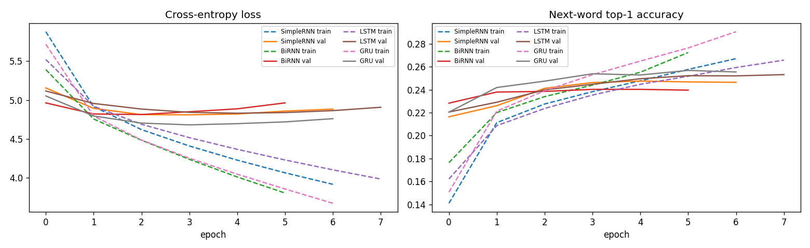
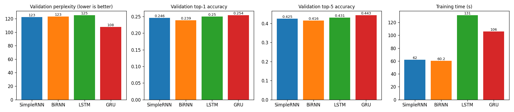
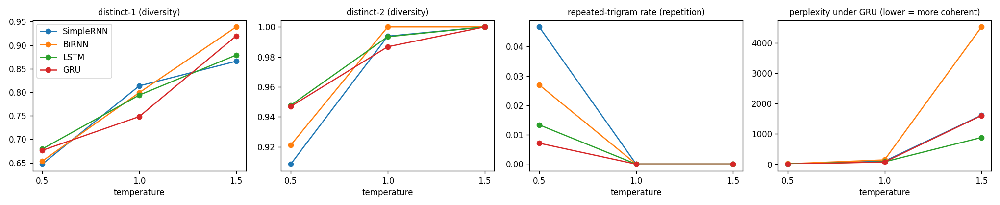

# Word-Level Autoregressive Shakespeare Text Generation with Simple RNN, Bidirectional RNN, LSTM and GRU

**Foundations of Generative AI (ICT4403) — Assignment 2**
Utkarsh Kumar Jha · Reg. No. 230953422

## 1. Problem statement and objective

Build an autoregressive text-generation system that predicts the **next word** from the previous words and generates
text one word at a time from a seed sequence. Four recurrent architectures are implemented: **Simple RNN,
Bidirectional RNN, LSTM and GRU**. They are trained under identical conditions and compared on:

* quantitative measures: loss, perplexity, top-1/top-5 next-word accuracy, training time;
* qualitative properties of the generated text: coherence, diversity, contextual consistency, repetition;
* the effect of the **sampling temperature** (T = 0.5, 1.0, 1.5) on the same seed sequences.

The goal is to identify the model that gives the most effective autoregressive generation for the dataset.

## 2. Dataset

**Tiny Shakespeare** from Andrej Karpathy's char-rnn repository
* Source: <https://github.com/karpathy/char-rnn/tree/master/data/tinyshakespeare>
* Raw file: <https://raw.githubusercontent.com/karpathy/char-rnn/master/data/tinyshakespeare/input.txt> (downloaded automatically by the notebook)

| Property | Value |
|---|---|
| Size | 1,115,394 characters, 40,000 lines |
| Words | 204,062 (12,631 unique, case-folded) |
| Speeches / distinct speakers | 7,805 / 892 |
| Avg. words per speech | 26.1 |
| Hapax legomena (words seen once) | 5,704 |

The file concatenates excerpts from Shakespeare's plays in script form: a `SPEAKER:` line, the speech, and a blank line.
The language is Early-Modern English with a mix of verse and prose and many proper names. Word frequencies follow
Zipf's law (`results/dataset_word_freq.png`).

**Pre-processing**
1. Lower-casing. Tokenisation into words (keeping apostrophes, e.g. `'tis`, `o'er`), punctuation tokens `. , ! ? ; : -`,
   and two layout tokens `\n` (line break) and `\n\n` (end of speech), so the models can learn the script format.
2. The vocabulary is the 10,000 most frequent tokens plus `<pad>` and `<unk>` (V = 10,002). It covers **99.07 %** of the 285,045 running tokens.
3. **Input–target sequences:** sliding window of 20 tokens → the next token (stride 1). The token stream is split
   contiguously **90 % train / 10 % validation** *before* windowing, so no validation target appears in a training window.
   This gives 256,520 training and 28,485 validation samples.

## 3. Models

All models share `Embedding(V, 128) → recurrent layer (256-d output) → Dropout(0.2) → Dense(V, softmax)`.
Only the recurrent layer changes:

| Model | Recurrent layer | Parameters | Description |
|---|---|---|---|
| Simple RNN | `SimpleRNN(256)` | 3.95 M | Plain tanh recurrence; cheapest, prone to vanishing gradients |
| Bidirectional RNN | `Bidirectional(SimpleRNN(128))` | 3.92 M | Reads the context window forwards and backwards (128 + 128 = 256). The target is outside the window, so there is no leakage, and generation is still left-to-right |
| LSTM | `LSTM(256)` | 4.25 M | Input/forget/output gates and a cell state for long-range memory |
| GRU | `GRU(256)` | 4.15 M | Update/reset gates; LSTM-like memory with fewer parameters |

**Comparable training conditions:** same data and split, seed 42, batch 256, Adam (lr 1e-3), sparse categorical
cross-entropy, at most 20 epochs, early stopping on validation loss (patience 3, best weights restored).

**Generation:** the last 20 tokens are fed to the model and the output distribution is rescaled by temperature,
p<sub>i</sub> ∝ exp(log p<sub>i</sub> / T). One token is sampled and the loop repeats for 60 tokens. Three fixed seeds × T ∈ {0.5, 1.0, 1.5}
× 4 models are generated, with the same RNG seed for every run.

## 4. Repository structure

```
FGAI_Assignment2_TextGen.ipynb   # complete implementation, executed on Colab (T4 GPU) with all outputs
requirements.txt
results/
  metrics.csv                    # quantitative metrics per model
  histories.json                 # per-epoch train/val loss and accuracy
  generated_samples.txt          # all 36 generated texts (4 models x 3 seeds x 3 temperatures)
  temperature_metrics.csv        # distinct-1/2, repetition, judged perplexity per model x temperature
  dataset_word_freq.png  loss_accuracy_curves.png  model_comparison.png  temperature_effect.png
```

## 5. Execution steps and dependencies

Dependencies: Python 3.10+, `tensorflow>=2.15`, `numpy`, `pandas`, `matplotlib`, `jupyter` (all preinstalled on Colab/Kaggle).

**Google Colab (recommended):** open the notebook, choose *Runtime → Change runtime type → T4 GPU*, then *Run all*.
The full run takes about 6 minutes of training plus generation. The dataset downloads automatically, and all results are written to `results/`
(and zipped to `results.zip`).

**Locally:**
```bash
pip install -r requirements.txt
jupyter notebook FGAI_Assignment2_TextGen.ipynb    # Run All
```
A CPU works but takes about 2–5 min per epoch per model. `EPOCHS=1 jupyter notebook …` gives a quick smoke test.

## 6. Results

| Model | Epochs run (best) | Val loss | **Perplexity** ↓ | Top-1 acc ↑ | Top-5 acc ↑ | Train time | s/epoch |
|---|---|---|---|---|---|---|---|
| Simple RNN | 7 (4) | 4.810 | 122.7 | 24.6 % | 42.5 % | 62 s | 8.9 |
| Bidirectional RNN | 6 (3) | 4.814 | 123.2 | 23.9 % | 41.6 % | 60 s | 10.0 |
| LSTM | 8 (5) | 4.830 | 125.3 | 25.0 % | 43.1 % | 131 s | 16.4 |
| **GRU** | 7 (4) | **4.680** | **107.8** | **25.4 %** | **44.3 %** | 106 s | 15.1 |




Sample outputs (seed `king richard :\nmy lord , what news`, T = 0.5):

> **GRU:** *…what news is a traitor. / welcome, come, i will not do your grace, / and give me well: therefore, what, i have / a little choice.*
>
> **LSTM:** *…what news is a maid to the devil. // king richard iii: / well, i are a thousand - place, sir.*
>
> **Simple RNN:** *…what news? // autolycus: / nay, sir, you have done, sir, / i have no more than the boar - day,*

All 36 samples are in [`results/generated_samples.txt`](results/generated_samples.txt).

## 7. Model comparison and evaluation

* **Predictive quality:** GRU is best on every metric. Its perplexity is ~12 % lower than the others, which lie within 2 % of each other.
* **Overfitting:** every model reaches its best validation loss at epoch 3–5. After that, training loss keeps falling while validation
  loss rises, because the corpus is small (~260 k windows) relative to a 10 k-word output layer. Early stopping keeps the best weights.
* **Training cost:** Simple and Bi-RNN are the fastest (~60 s). GRU is cheaper per epoch than LSTM and needs fewer epochs.
* **Simple RNN:** with a 20-token window its perplexity is competitive, but it **forgets the seed**. For two different seeds at
  T = 0.5 it produced the *identical* continuation ("…, sir, you have done, sir, / i have no more than the boar - day, …"). It also has
  the highest repetition (4.7 % repeated trigrams).
* **Bidirectional RNN:** no gain, because the word to predict lies after the window and the backward pass adds little. It also loops on phrases
  ("the world, to thee the work of the world").
* **LSTM:** good speaker/line structure and diversity. Occasionally degenerates ("to - - - - -"), and it is the slowest to train.
* **GRU:** the most fluent and context-consistent text, which keeps the seed's register (king / lord / grace), with the lowest repetition (0.7 %).
* All models learned the play-script format (speaker → `:` → lines → blank line). Sentences are coherent only locally, which
  is typical of word-level RNNs trained on ~200 k words.

| Qualitative | Simple RNN | Bi-RNN | LSTM | GRU |
|---|---|---|---|---|
| Coherence | low | fair | good | **best** |
| Diversity | medium | medium | high | high |
| Contextual consistency | poor | weak | fair | **best** |
| Repetition (T=0.5) | 4.7 % | 2.7 % | 1.3 % | **0.7 %** |

## 8. Sampling-temperature analysis



Mean over three seeds (range across the four models):

| T | distinct-1 | distinct-2 | repeated trigrams | perplexity of the sample under the GRU |
|---|---|---|---|---|
| 0.5 | 0.65 – 0.68 | 0.91 – 0.95 | 0.7 – 4.7 % | 11 – 21 |
| 1.0 | 0.75 – 0.81 | 0.99 – 1.00 | 0 % | 79 – 149 |
| 1.5 | 0.87 – 0.94 | 1.00 | 0 % | 883 – 4522 |

* **T = 0.5:** the most coherent and grammatical text, with real speaker names. It has the least diversity, and it is the only setting with repetition
  (stock phrases such as "my lord", "i will not", and short loops).
* **T = 1.0:** a balanced setting. Vocabulary is much richer and repetition disappears. The script structure survives, but grammar weakens
  (*"i aim no knee, as a surfeit young fortune"*).
* **T = 1.5:** word salad. Rare words are sampled constantly, the format breaks and speaker names are invented
  (*"duke of throne breast real friends:"*). The sample perplexity rises 10–50×.
* Temperature therefore trades **coherence against diversity** monotonically, and repetition is a problem only at low temperature.
  **T ≈ 0.5–1.0** gives the best output. (Caveat: the GRU is also the judge, which slightly favours its own samples. The LSTM's
  samples score similarly, and manual reading agrees with the ranking.)

## 9. Conclusion

**GRU is the best-performing model** for autoregressive generation on Tiny Shakespeare:
* lowest validation perplexity (**107.8** vs ≥ 122.7) and highest top-1/top-5 accuracy (**25.4 % / 44.3 %**);
* the most coherent, least repetitive and most context-consistent generated text;
* about 20 % faster to train than the LSTM.

The LSTM is a close second in sample quality. The Simple RNN is fast but loses its context. The Bidirectional RNN offers
no advantage for next-word prediction. For generation, a temperature between 0.5 and 1.0 gives the best balance of coherence and diversity.
